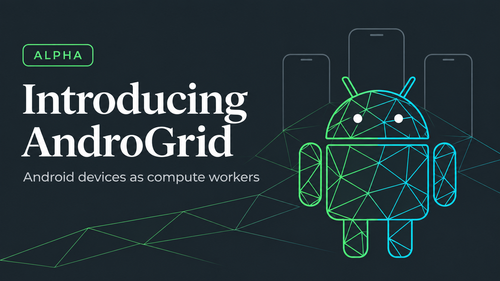
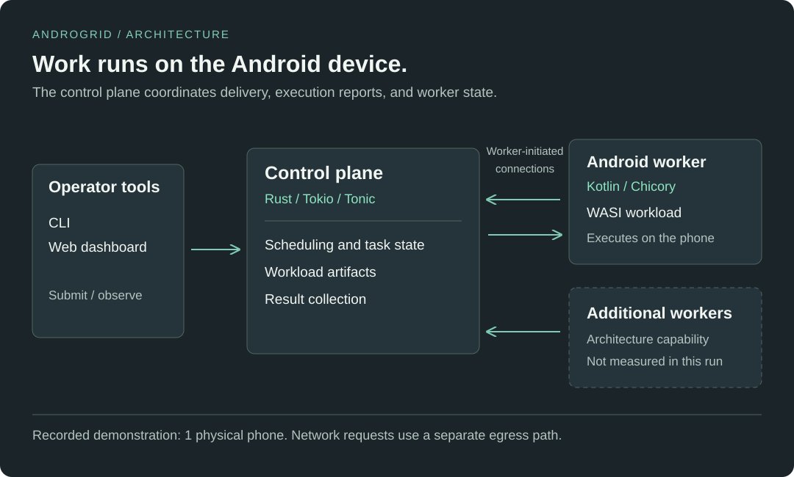
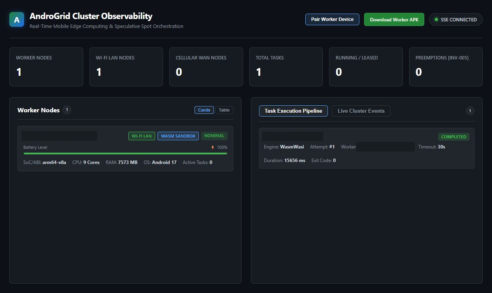
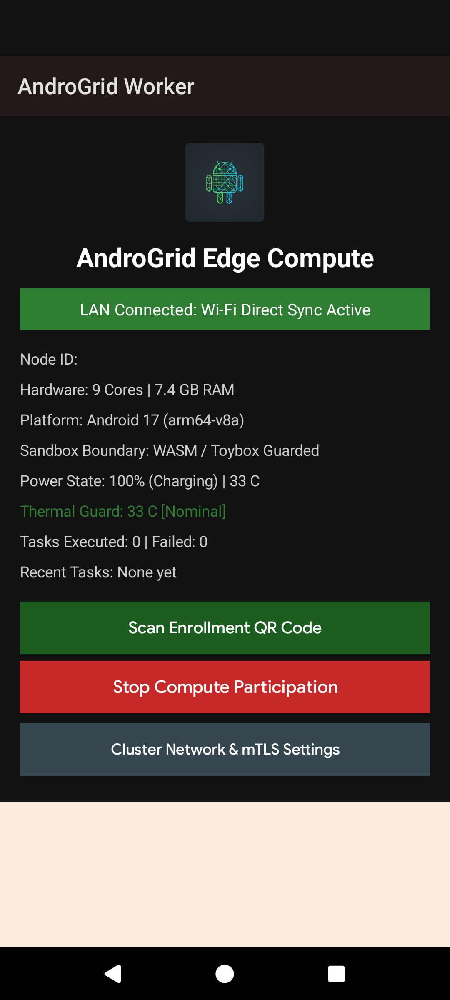
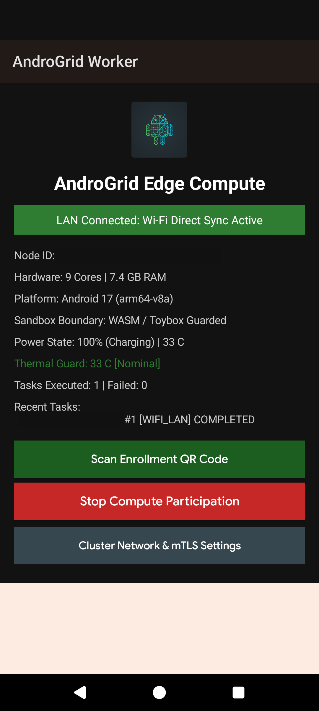

# Introducing AndroGrid: Android Devices as Compute Workers

*An open-source alpha exploring useful work beyond the desktop, with a performance-testing demonstration on a physical Android phone.*

By Nir Rozen

AndroGrid started with a practical question: could I expand the computing resources available to me by making better use of hardware I already had access to?

Android devices seemed worth exploring. They combine processors, memory, storage, and connectivity in a compact package. Making them useful workers, however, introduces a different set of problems: how to deliver work, control what it can do, collect results, and cope with devices that become unavailable.

I began building AndroGrid to explore those problems. From the outset, I wanted room for different applications. Performance testing became a concrete starting point because it makes execution and network behavior visible and measurable.

AndroGrid is now an **open-source alpha**. This article introduces the platform, shows a small demonstration, and explains where I want to take it next.



## What AndroGrid does

AndroGrid connects a self-hosted control plane to Android devices under the operator's control. An operator submits a workload; an eligible worker obtains it, executes it, and reports the outcome.

The control plane is written in **Rust**, using Tokio and Tonic. The Android worker is written in **Kotlin**. For the WebAssembly execution path discussed here, the worker uses **Chicory with WASI Preview 1**. WASI provides a set of interfaces through which a WebAssembly module can interact with its execution environment. Modules must fit the capabilities exposed by this runtime.

This division keeps workload logic separate from coordination. A developer writes the computation or request sequence. AndroGrid handles assigning work to workers and collecting execution reports. The current platform also provides a CLI and a web dashboard for observing workers and tasks.



*The architecture supports multiple workers. The HTTP demonstration below used 1 phone. Worker-initiated cluster communication and workload HTTP egress are separate paths.*

[Open the architecture at full size](figures/01-architecture.svg).

The selected execution path uses an unrooted Android device. Workloads receive the host capabilities configured for them, including controlled HTTP access when enabled. Cluster authentication, the WASI boundary, and outbound network restrictions address different parts of the problem. Their presence does not establish complete isolation or production readiness. Other execution modes and their restrictions are described in the project documentation.

## Where it could be useful

I see AndroGrid as a place to explore workloads that can be divided into independent, bounded jobs. The useful question is whether Android workers offer something relevant to that particular job: available hardware, a useful network vantage point, local processing, or an accessible experimental environment.

| Application | A possible job | Current evidence |
| --- | --- | --- |
| Performance testing | Generate HTTP requests and collect latency and error measurements from Android workers. | Demonstrated on 1 physical phone in the run below. Multi-device load generation needs its own measurements. |
| Numerical batch work | Run independent calculations or parameter sweeps. | A prime-calculation starter workload exists. A complete scientific workflow remains a candidate application. |
| Data preprocessing | Validate records, calculate checksums, or transform independent data chunks. | Candidate application requiring a verified input, output, and aggregation workflow. |
| Image and document preprocessing | Process independent images or document chunks locally. | Candidate application requiring a working processing pipeline and verified outputs. |
| Education and research | Explore scheduling, heterogeneous workers, interruption, and result collection. | A possible use of the platform and its examples; a reproducible lab exercise would make it more accessible. |

Retail tablets, warehouse handhelds, or devices in a home lab are possible deployment contexts. They are not established customer deployments. Using hardware for an additional workload also has operational costs and may conflict with its primary role.

These possibilities need experiments. I have not established that distributing a workload across phones makes it faster, cheaper, or more energy efficient than running it on another machine. That depends on the workload, runtime, data movement, device behavior, and host overhead.

## Why test on real Android devices?

If I already have a load generator, why bring phones into the experiment? The reason is to investigate what changes when a request originates on an actual Android device, using the network available at its location. Connection count, device diversity, and network diversity answer different questions.

### More connections do not create more client environments

A load generator can open 1,000 connections and exercise server concurrency. Those connections still share the execution environment and network configuration of the generators that created them. Increasing their number does not introduce 1,000 independent Android devices, Wi-Fi links, or Internet access paths.

| Test arrangement | What it can help investigate | What remains shared or untested |
| --- | --- | --- |
| Many virtual clients on 1 generator | Server response to a controlled request rate, concurrency, and workload mix. | The generator's resources and network origin; individual phones are not represented by connection count alone. |
| Multiple physical phones on 1 Wi-Fi network | Behavior across actual Android devices, their execution environments, and their wireless links. | The phones may still share an access point, gateway, DNS configuration, and upstream Internet connection. |
| Devices at different operational locations | Service behavior through the access networks and routes available at those locations. | Coverage depends on the chosen devices, locations, and workloads; a fleet is not automatically representative of all users. |

Virtual machines can also be placed in different networks, and network emulation can reproduce selected conditions under controlled settings. Physical devices add value when the hardware, Android environment, or actual access network is part of the question. They do not make every performance test more accurate by default.

### Where the HTTP request actually runs

In the inspected AndroGrid implementation, the WASI workload calls the `androgrid_net` HTTP host bridge. The [Android host module](https://github.com/ligature-platform/androgrid-android/blob/e897036d91903df3dae1d821d05ad9d6846d7f31/app/src/main/kotlin/com/androgrid/worker/engine/WasmNetworkEgressHostModule.kt) performs the request using OkHttp inside the worker process. Its task client disables an explicit HTTP proxy; it does not forward the workload's HTTP requests through the orchestrator. That setting does not bypass device-level VPNs or other network controls.

The control plane coordinates the job and collects its report. The phone performs the computation and makes the HTTP calls. Consequently, the HTTP path can include that phone's Wi-Fi link, local gateway, Internet provider, and the route to the target. Network-specific DNS or routing decisions may also change which service endpoint is reached. Android exposes network routes, DNS servers, transports, and VPN information through its [connectivity APIs](https://developer.android.com/develop/connectivity/network-ops/reading-network-state); the transport label alone is not a complete description of that path.

The execution environment matters too. Work generation and processing take place under Android's scheduling, available CPU and memory, and the overhead of the chosen WASI runtime and HTTP client. Physical devices also have thermal and power constraints. Android's [thermal guidance](https://developer.android.com/games/optimize/adpf/thermal) explains how thermal state can limit performance. These are factors to control and observe in longer experiments, not effects established by the short run in this article.

### The question this can answer

Consider a hypothetical investigation: a service performs well from a data-center load generator, while an Android device at a particular site reports slow requests. Running a controlled workload from that device gives the engineer another observation to compare with server telemetry and measurements from other locations. The difference is a reason to investigate the device and end-to-end path; it does not by itself identify the phone, Wi-Fi, ISP, or server as the cause.

Reaching a production server is not the distinguishing feature: an ordinary load generator can do that too. The useful distinction is the environment from which the request originates. A spare phone in a lab supplies a real device, but it does not become a production-user environment simply because the target is live. That requires deliberate placement, appropriate permission, and a workload relevant to the behavior under investigation.

Real-device testing and endpoint monitoring already exist, including [HeadSpin's real-device performance testing](https://www.headspin.io/solutions/performance-testing) and [ThousandEyes' Android endpoint agent](https://www.thousandeyes.com/product/endpoint-agents/). My interest with AndroGrid is a self-hosted, open-source way to coordinate custom, compatible workloads on Android devices I control. That is a reason to explore the platform, not a claim that it is the first or that its results are superior.

### What the current demonstration covers

The experiment below establishes HTTP execution and result collection on 1 physical Android phone over Wi-Fi. The workload uses the worker's HTTP client, not Chrome or a WebView: it does not render pages, execute a site's JavaScript, or measure a complete browser user journey. Device-side measurements must also be interpreted alongside server measurements; slow requests do not automatically mean slow server processing.

The [reviewed egress guard](https://github.com/ligature-platform/androgrid-android/blob/e897036d91903df3dae1d821d05ad9d6846d7f31/app/src/main/kotlin/com/androgrid/worker/engine/WasmNetworkEgressSecurityGuard.kt) blocks HTTP egress on metered connections and rejects private, loopback, and link-local destination addresses. This article therefore does not offer cellular HTTP load generation or testing of private intranet HTTP targets through that execution path.

The next useful validation is a controlled comparison across devices and locations, keeping the workload, target behavior, connection settings, and measurement boundaries explicit. Conventional load testing can establish server capacity while physical Android workers investigate selected device and access-network conditions. The recorded run is the starting point for that comparison.

## Starting with HTTP performance testing

For the recorded demonstration, I submitted an HTTP workload to a physical **Google Pixel 8**. The worker reported version **0.0.1-alpha.5** and an Android 17 environment. The workload ran through the WASI execution path and issued HTTP GET requests to a public HTTPS echo endpoint.

The workload sends 1 request at a time and waits for its result before sending the next. The numbers below describe that sequential loop. I used it to check that the execution path worked before attempting a larger load experiment.

<figure class="ag-workflow" aria-labelledby="ag-flow-caption">
  <div class="ag-flow-stage" data-ag-workflow>
    <div class="ag-flow-top"><span class="ag-flow-kicker">Demonstration workflow</span><button type="button" class="ag-flow-replay" hidden>Replay animation</button></div>
    <div class="ag-flow-nodes">
      <div class="ag-flow-node" data-ag-node="control"><span class="ag-flow-icon" aria-hidden="true">01</span><strong>Control plane</strong><span>Lease task / collect result</span></div>
      <div class="ag-flow-link"><span>USB coordination</span><i class="ag-packet ag-packet-task" aria-hidden="true"></i><i class="ag-packet ag-packet-result" aria-hidden="true"></i></div>
      <div class="ag-flow-node" data-ag-node="phone"><span class="ag-flow-icon" aria-hidden="true">02</span><strong>Android worker</strong><span>Execute the WASI module</span></div>
      <div class="ag-flow-link"><span>Wi-Fi HTTP traffic</span><i class="ag-packet ag-packet-http" aria-hidden="true"></i></div>
      <div class="ag-flow-node" data-ag-node="target"><span class="ag-flow-icon" aria-hidden="true">03</span><strong>HTTP target</strong><span>Return HTTP responses</span></div>
    </div>
    <p class="ag-flow-status" role="status">A worker obtains a task, makes HTTP requests, and returns a result.</p>
  </div>
  <figcaption id="ag-flow-caption">Illustrative workflow, not real-time benchmark playback. The animation compresses the sequence into 6 seconds and does not represent throughput.</figcaption>
</figure>

Direct Wi-Fi connectivity between the Android worker and the orchestrator was restricted by the test environment's network security controls. I used USB reverse forwarding for cluster coordination and workload delivery. Separately, the workload's HTTP requests traveled from the phone to the external HTTPS target over Wi-Fi. The workload executed on the phone's CPU.

This run therefore does not validate fully wireless onboarding or cellular operation. The network-path description comes from the recorded setup; the dashboard's Wi-Fi label alone does not establish the route of a particular connection.

### What the run reported

| Measurement | Recorded value |
| --- | ---: |
| Participating Android devices | 1 |
| HTTP requests | 76 |
| HTTP 200 responses | 76 |
| Reported request errors | 0 |
| Workload measurement window | 15.151075 s |
| Reported request rate | 5.016 requests/s |
| Median request latency | 177.872 ms |
| p95 request latency | 181.641 ms |
| Task execution duration reported by the orchestrator | 15,656 ms |
| Task exit code | 0 |

The workload measurement window and orchestrator-reported execution duration are different measurements. The workload's request rate is calculated over its own window. Neither value is a measurement of the complete operator submission-to-result interval.



*Dashboard evidence of the recorded task. Identifiers are hidden for publication. The UI's Wi-Fi classification does not mean the control-plane connection was wireless.*

The result establishes a useful milestone: a workload reached a physical Android worker, performed network I/O, and returned a successful execution report with measurements. It does not establish maximum throughput, fleet-scale behavior, sustained thermal performance, or service reliability. With 76 requests, tail statistics also need cautious interpretation.

The [sanitized results and measurement notes](evidence/) accompany this article, including a [sanitized execution-log excerpt](evidence/execution.txt). For meaningful load experiments, use a target you own or have permission to test. A controlled endpoint and repeated runs are the next steps toward useful comparisons.

## Walkthrough: send a task and inspect the result

Here is the operator workflow for a small HTTP experiment. The commands use **PowerShell on Windows**, an alpha.5-compatible control plane and worker, and the same USB coordination approach described above. They are a reader lab, not a replay of the recorded run. The command flags were checked against the alpha.5 CLI; a fresh installation of this walkthrough has not been verified end to end.

### 1. Prepare the control plane and operator CLI

Start with the project's [installation guide](https://ligature-platform.github.io/androgrid-backend/getting_started/quickstart.html). You need a running control plane, its root CA certificate, and the operator's client certificate and private key. Those credentials must belong to the same cluster. Keep them local.

The [Windows USB lab setup](evidence/windows-usb-lab.md) provides the source revisions, build commands, certificate initialization, and loopback-only host configuration used as the basis for this walkthrough. It also explains which parts still need a clean-install verification.

In a separate PowerShell terminal, from the backend repository root, configure the CLI. These paths match the lab setup; replace them if you used a different installation:

```powershell
$Cli = (Resolve-Path '.\target\release\androgrid-cli.exe').Path
$env:ANDROGRID_ENDPOINT = 'https://127.0.0.1:50051'
$env:ANDROGRID_CA_CERT = (Resolve-Path '.\demo-data\pki\runtime\ca.crt').Path
$env:ANDROGRID_CLIENT_CERT = (Resolve-Path '.\demo-data\pki\operator\admin.crt').Path
$env:ANDROGRID_CLIENT_KEY = (Resolve-Path '.\demo-data\pki\operator\admin.key').Path
& $Cli --version
& $Cli nodes
```

**Check:** the CLI can query the cluster. Before enrollment, an empty worker list is expected. A TLS error needs to be resolved before submitting work.

### 2. Connect and enroll the Android worker

Connect a supported spare phone over USB, authorize USB debugging, and keep it on unmetered Wi-Fi for the workload's HTTP traffic. The examples assume exactly 1 ADB device is connected:

```powershell
adb devices
adb reverse tcp:50051 tcp:50051
adb reverse tcp:50052 tcp:50052
adb reverse --list
```

Install the matching worker APK using the [worker guide](https://ligature-platform.github.io/androgrid-backend/android/worker_guide.html). In the loopback lab, the dashboard advertises `127.0.0.1:50051`, which the phone reaches through ADB reverse forwarding. Open `http://127.0.0.1:8080/` on the host, select **Pair Worker Device**, and scan the fresh code with the worker app. If pairing expires, generate a fresh code. Do not publish that code or its token.

**Check:** the worker appears in `& $Cli nodes` and in the dashboard. The capture below shows the connected worker from the recorded session; it does not establish which enrollment method succeeded in that session.

<figure class="ag-phone-shot">
  <a href="figures/04-worker-connected.png"></a>
  <figcaption>Recorded worker screen. The connection label is a route classification; coordination in this experiment used USB forwarding.</figcaption>
</figure>

### 3. Build and validate the HTTP workload

From the backend repository root:

```powershell
rustup target add wasm32-wasip1
cargo build --locked --release --target wasm32-wasip1 `
  --manifest-path .\workloads\http-benchmark\Cargo.toml
$Wasm = (Resolve-Path '.\workloads\http-benchmark\target\wasm32-wasip1\release\http_benchmark.wasm').Path
& $Cli pack --wasm $Wasm --entrypoint _start
```

**Check:** the WASI module passes packaging validation. This checks the artifact's accepted structure, rather than proving that every runtime behavior is correct.

### 4. Submit a bounded HTTP task

Replace the example URL below with a **publicly reachable HTTPS test endpoint you control or have permission to test**. The reviewed egress guard rejects private, loopback, and link-local destination addresses, so a service on your host's `localhost` is not a suitable HTTP target for this lab.

```powershell
$TargetUrl = 'https://your-public-test-host.example/health'
$TargetHost = ([uri]$TargetUrl).DnsSafeHost
& $Cli submit --wasm $Wasm --timeout 30 --requires-unmetered `
  --env "TARGET_URL=$TargetUrl" --env 'METHOD=GET' `
  --env 'DURATION_SECS=15' --env 'MAX_REQUESTS=100' `
  --egress-policy allowlist --allowed-hostnames $TargetHost `
  --max-egress-bytes 10485760
```

The task stops at the duration or request-count limit, whichever it reaches first, subject to the workload's request handling and task timeout. The byte quota bounds egress for the attempt. `MAX_REQUESTS=100` is an additional limit in this reader example. There is no `CONCURRENCY` setting here: the inspected request loop is sequential.

**Check:** the CLI reports that the task was accepted and prints its task ID. Copy that ID for the next step. Acceptance means the task entered the queue; completion is a separate observation.

### 5. Inspect the task report and worker ledger

```powershell
$TaskId = 'paste-the-task-id-returned-by-submit'
& $Cli status $TaskId
```

Query again if the task is pending or running. In the recorded experiment, the report contained the following values. Identifiers and the target URL have been removed from this excerpt:

```text
State:     COMPLETED
Attempt:   1
Exit Code: 0
Duration:  15656 ms

Total Requests:      76
Successful (2xx):    76
Total Errors:        0
Throughput:          5.02 req/sec (1.64 KB/sec)
```

These are values from the retained report, not expected values for your host, target, or device. Read the workload's HTTP status and error counts as well as the task's exit code. A successful process exit alone is not sufficient evidence of a useful result.

<figure class="ag-phone-shot">
  <a href="figures/05-worker-ledger.png"></a>
  <figcaption>The recorded worker ledger after completion. The dashboard, CLI report, and worker ledger provide different views of the same task.</figcaption>
</figure>

### 6. Keep the evidence and finish the session

Save the task report, workload inputs, device details, and network setup so you can compare subsequent runs. The [recorded results and execution log](evidence/) show what I retained from this experiment. Keep full logs private when they contain credentials or identifiers.

When finished, stop compute participation in the worker app. If the task is still active, cancel it before removing the USB path:

```powershell
& $Cli cancel $TaskId
adb reverse --remove tcp:50051
adb reverse --remove tcp:50052
```

The cancel command is needed only for an active or pending task. Stop the lab backend in its terminal when you have finished inspecting its state.

## What alpha means here

Interfaces, packaging, and operational behavior can still change. Hardware coverage is limited, and Android versions, OEM background policies, charging state, and network configuration can affect the experience. The recorded worker version is not a substitute for checking the compatibility of the exact backend, APK, and workload you install.

I would begin with a supported spare device, a trusted network, and a small workload. This article does not claim validated battery savings, long-term device longevity, seamless operation across Android models, or complete recovery across orchestrator restarts.

The thermal guard in the inspected execution path controls admission of new work. It should not be read as a promise that an already running workload immediately stops when a temperature threshold is crossed. Operational safeguards need their own tests.

## Where I want to take it

My immediate priorities are making installation easier to reproduce, validating physical wireless operation, and testing more devices over longer runs. For performance testing, I want controlled targets, repeatable inputs, verified result collection, and measurements that separate workload execution from coordination overhead.

Beyond that, I am exploring stronger diagnostics, more durable coordination, and operation across a broader mix of hardware. Linux workers and suitable edge AI workloads are longer-term directions. They require feasibility work on runtime support, memory, communication, and recovery before I can describe them as working capabilities.

I want useful experiments to guide that work. The value of an additional execution environment comes from the jobs it can actually complete, the constraints it respects, and the evidence it produces.

## Explore the project

The [central documentation portal](https://ligature-platform.github.io/androgrid-backend/) covers the architecture, operator tools, workload development, and installation. The [Android worker documentation](https://ligature-platform.github.io/androgrid-android/) covers the mobile client. Source is available in the [control-plane repository](https://github.com/ligature-platform/androgrid-backend) and [Android worker repository](https://github.com/ligature-platform/androgrid-android).

AndroGrid is open source. You can explore the code and documentation, try a suitable workload, or follow its progress. Feedback, experiments, and contributions are welcome.

*Author note: I am AndroGrid's sole human developer, with AI assistance during development.*
