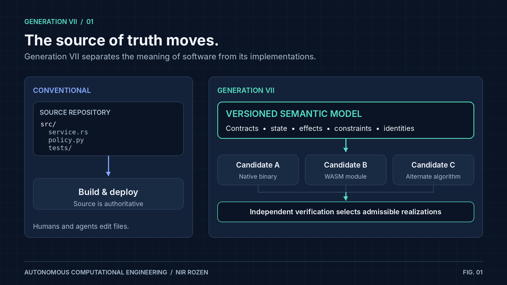
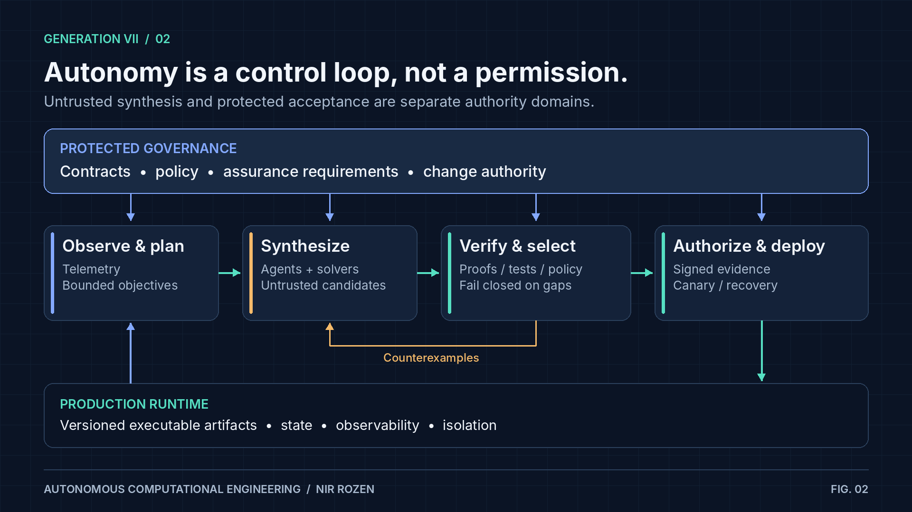
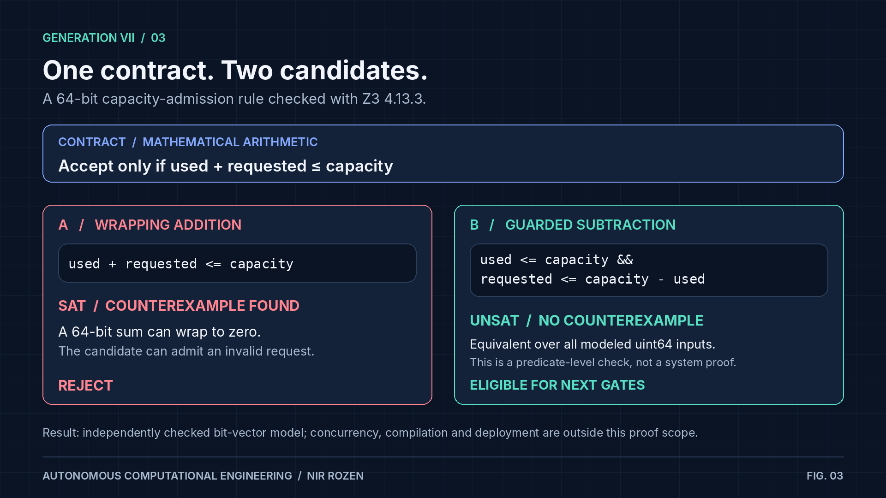
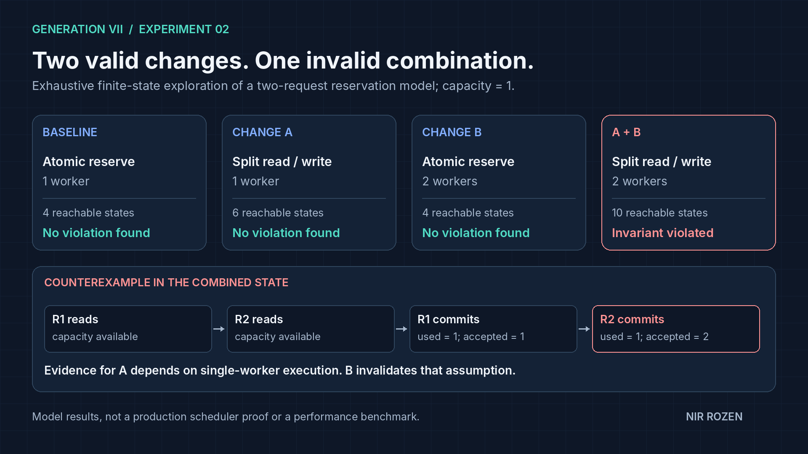

# Generation VII: Autonomous Computational Engineering

*Beyond AI-written code: Toward a machine-native architecture for governed, verified and continuously evolving software.*

By Nir Rozen

Much of the conversation about AI and software engineering revolves around a familiar question: how much of a developer's work can an agent do?

I find another question more interesting. If agents eventually become the primary producers and maintainers of software, would we still design the engineering environment around source files, editors, pull requests and human-readable programming languages?

My background in systems, performance, scale and quality engineering has taught me to distinguish the ability to produce a change from the ability to establish that the change is safe. Those are different engineering problems. The faster we solve the first, the more important the second becomes.

I want to explore what software engineering could look like if autonomous machines, rather than human developers, were its principal operators. I call this proposed framework Generation VII, or Autonomous Computational Engineering (ACE).

This is a personal technical perspective and a research proposal, not an assertion that the industry has entered a new generation or that the underlying ideas are all original.

## 1. From coding autonomy to engineering autonomy

I distinguish three stages in the possible evolution of AI-driven software development:

| Stage | What changes |
|---|---|
| Generation V: AI-assisted programming | Agents write and maintain conventional source code. |
| Generation VI: AI-native programming | Agents synthesize implementations from explicit semantic specifications. |
| Generation VII: Autonomous Computational Engineering | Agents continuously evolve computational systems within independently enforced behavioral, security and operational constraints. |

These labels are my own conceptual classification. The important distinction is not the numbering. It is the difference between automating implementation and automating the engineering decisions that govern it.

There is considerable prior work. Autonomic computing introduced self-management against high-level objectives in 2003 ([Autonomic computing](https://doi.org/10.1109/MC.2003.1160055)). Model-driven engineering, program synthesis, dynamic software updating and self-adaptive systems have been studying related problems for decades ([Dynamic software updates](https://drum.lib.umd.edu/items/e0d14543-3cd2-4096-b1d9-0f7ffc3ae2ff), [Model transformation and property preservation](https://doi.org/10.1016/j.jss.2025.112508)). More recent work on autonomous software development, verification agents and semantic artifacts goes directly to the question of what happens when source code is no longer the primary artifact ([Autonomous software development](https://rdi.berkeley.edu/assets/position-auto-sd.pdf), [Verification agents](https://arxiv.org/abs/2611.02285), [Semantic artifacts](https://arxiv.org/abs/2611.23249)). StrongDM describes an industrial software factory driven by specifications and externally maintained evaluation scenarios ([StrongDM’s software factory](https://factory.strongdm.ai/)). SysMARA makes architectural constraints accessible to agents through an explicit system graph ([AI-readable architecture](https://doi.org/10.66308/air.e2026043)).

These efforts are important precisely because they show that the general vision is not new. My interest is in an engineering problem that remains open at scale: how to govern changes to software, its execution environment, its specifications and the evidence supporting its operation as parts of one coherent process. A recent systematic review of formal verification under microservice evolution identifies related gaps in keeping verification artifacts aligned with changing systems ([Formal verification under microservice evolution](https://doi.org/10.3390/software5030032)).

## 2. What would become the source of truth?

A source repository tells us how software is implemented. It does not necessarily tell us which aspects of that implementation are intentional, which are accidental, and what must remain true when the system changes.

I would make those distinctions explicit in a versioned semantic model. I use the term Semantic Computational Graph (SCG) for a representation connecting operations, types, contracts, state transitions, dependencies, permitted effects, environmental assumptions and assurance evidence.

*Figure 1. A behavioral contract can have multiple implementations.*

The graph need not be a universal language. It could connect several specialized representations: typed compiler IRs for computation, transition systems for concurrency, logical formulas for contracts and explicit topology models for infrastructure. MLIR already demonstrates the value of manipulating computational representations independently of their textual syntax ([MLIR](https://mlir.llvm.org/docs/LangRef/)).

Agents would query this model and propose structured changes. Source code would remain useful for interoperability, debugging and compilation, but it would no longer have to be the authoritative development interface.

This does not mean eliminating abstraction, modularity or readable representations. Machines also face context limits, search complexity and computational costs. Good abstractions remain useful; they simply need not be designed around human readability alone.

People would author and inspect intent through behavioral scenarios, examples, contracts and diagrams linked to the underlying model. A reservation owner could specify that two successful reservations consume two units of capacity, inspect counterexamples and approve a proposed change to that requirement. Experience with the running system would produce versioned revisions of intent, including unresolved questions and conflicts. Specifications would evolve as users discover what they need.

The connection between those views and the formal representations is another assurance obligation. An agent-generated explanation can misdescribe a specification. Reviews should expose the actual contract changes, their linked scenarios and the evidence supporting the translation into the model.

## 3. Governing what software is allowed to become

Operating systems and security mechanisms govern what running programs may do. I would like to apply a similarly explicit discipline to what programs may become.

The authoritative state of an ACE-managed system includes its semantic model, approved implementation artifacts, relevant infrastructure configuration, assumptions, assurance evidence and governing policy. Changes are proposed as transactions against an identified revision, rather than accepted simply because an agent has produced a plausible patch.

Each transaction identifies what it changes, what it must preserve, the dependencies and assumptions on which it relies, the evidence required, and the authority that permits it.

The platform needs an enforceable basis for deciding which obligations a change triggers. I would start with restricted, typed transaction formats and protected rules that derive obligations from the affected artifacts, interfaces and declared effects. Consider five illustrative classes.

| Change class | Example | Required checks and authority |
|---|---|---|
| Implementation | Replace a resource-admission predicate | Contract preservation and resource constraints; delegated implementation authority |
| Architecture or infrastructure | Increase the number of concurrent writers | Cross-component invariants, compatibility and environment assumptions |
| Persistent state | Change a database schema | Migration correctness, mixed-version compatibility and recovery or compensation |
| Specification | Change a project's authorization behavior | Explicit authority to alter intent and reassessment of affected obligations |
| Governance | Change a mandatory security or verification rule | Separately protected policy authority, independent review or its authorized equivalent |

A proposal can have several effects and must satisfy all applicable obligations. A performance optimization cannot silently become a change to business requirements. A schema migration cannot be treated like a stateless binary replacement.

An agent could attach a certificate establishing a required property, following the principle of [proof-carrying code](https://doi.org/10.1145/263699.263712). The trusted side must determine the obligations and check the evidence against the exact candidate, specification and environment. A functional-equivalence result can leave timing, resource use or concurrent behavior outside its scope. The proposer cannot remove an obligation by omitting it from its submission.

This approach depends on a deliberately restricted semantic domain. General behavioral equivalence is undecidable, and a certificate does not make every verification task inexpensive. [Alive2](https://doi.org/10.1145/3453483.3454030) illustrates a narrower mechanism for checking LLVM transformations for refinement, with bounded treatment of loops. Unsupported effects, insufficient evidence and exhausted verification budgets must lead to rejection, deferral or separately authorized review.

I refer to the protected policy that defines these rules as the Computational Constitution. The term is not meant to suggest a new formalism. It describes a set of machine-enforced boundaries: which changes may be made, by whom, under what evidence requirements, and which rules ordinary implementation agents cannot modify.

*Figure 2. The engineering control plane proposes and evaluates changes; protected controls authorize them.*

A transaction may advance the authoritative revision only if the required evidence is applicable and the base revision is still current, or the proposal has been safely rebased and revalidated. The controller must also check authorization when admitting the exact artifact and configuration to production. Deployment itself is a distributed process with intermediate states, not an atomic database commit. It needs its own compatibility and recovery rules.

The aim is not universal mathematical proof. It is to make the obligations, evidence, uncertainty and authority behind each change explicit and enforceable.

## 4. Two small experiments: from a correct operation to a correct evolution

To make the discussion less abstract, I used AI assistance to prepare two reproducible experiments.

The first concerns a resource-admission predicate. Given unsigned 64-bit values for used capacity, requested capacity and total capacity, the mathematical sum of the first two must not exceed the third.

The obvious implementation, `used + requested <= capacity`, can incorrectly accept a request if unsigned addition wraps. An alternative, `used <= capacity && requested <= capacity - used`, avoids that problem.

The accompanying SMT-LIB model uses a 65-bit reference sum and Z3 4.13.3. The solver returned SAT for the query asking whether the wrapping implementation disagrees with the contract, and UNSAT for the guarded alternative. One counterexample is used = 2^64 - 3, requested = 3 and capacity = 2^64 - 2. The mathematical contract rejects the request; the wrapping sum is zero and the first candidate accepts it.

*Figure 3. Equivalence checking within the specified bit-vector model.*

This establishes the guarded predicate's equivalence to the modeled contract, not the correctness of a scheduler, compiled binary or concurrent reservation protocol.

The second experiment asks a more interesting question for Generation VII. Suppose a scheduler has one worker and an atomic reservation operation. Agent A proposes a faster-looking implementation that separates reading available capacity from recording a reservation. Under the single-worker assumption, those actions cannot interleave with another request. Agent B independently proposes increasing the number of workers from one to two. With the original atomic operation, that is safe in the model.

What happens if the two changes are combined?

I explored the reachable states of a deliberately small Python model with capacity for one reservation and two unit requests. Its invariant is that accepted reservations must not exceed capacity and must equal recorded usage.

| Configuration | Reachable states | Result |
|---|---:|---|
| Original: atomic operation, one worker | 4 | No violation found |
| A: split read/write, one worker | 6 | No violation found |
| B: atomic operation, two workers | 4 | No violation found |
| A + B: split read/write, two workers | 10 | Violation found |

*Figure 4. Actual results from exhaustive exploration of the small reservation model.*

In the combined configuration, both requests observe available capacity before either records its reservation. Both are then accepted, even though recorded usage is one.

This is a familiar lost-update problem, not a novel concurrency discovery. The engineering point is that software verification and infrastructure validation cannot always be treated as independent approval processes. The evidence for change A depends on an environmental property that change B invalidates.

A correctly designed evolution controller should refuse to reuse that evidence in the combined state. It should recheck the affected obligations before authorization. If it cannot establish the relevant guarantee, it should reject or defer the change.

The companion admission experiment now makes that decision executable within the same finite model. Its evidence records identify the model, invariant, implementation and worker count. It accepts the split operation with applicable single-worker evidence, rejects reuse of that evidence for two workers, and rejects the combined configuration again after exhaustive re-verification finds a violation. Scaling the atomic operation to two workers remains admissible. Additional checks reject evidence for a changed implementation, model identity or claim.

The admission check consumes records returned by the local verifier. Authenticating evidence producers, deploying real workers and governing distributed updates remain prototype work. The animations below replay the recorded counterexample and the admission decisions.

[Reproduce both experiments](experiments/README.md).

Both experiments are small, executable illustrations. They do not demonstrate that the proposed platform exists, that the split implementation is faster, or that the approach scales. The code and recorded results accompany the article.

[Play or step through the reservation counterexample](experiments/reservation-trace.html).

## 5. Assurance must evolve with the system

Passing CI at one point in time does not mean a system remains acceptable indefinitely. Dependencies change, workload assumptions become obsolete, configurations drift and vulnerabilities are disclosed.

Research such as ENTRUST already recognizes that assurance cases for self-adaptive software must evolve alongside the system ([ENTRUST](https://doi.org/10.1109/TSE.2017.2738640)). I would extend that principle into the proposed engineering protocol.

Each evidence item should identify its claim, the artifact and specification versions it covers, its dependencies and assumptions, the verification method, the result and the applicable policy. A proof is not the same as a bounded model-checking result, a test, a benchmark or a signed attestation. The platform should preserve those differences rather than reduce everything to a single green checkmark.

An assumption change should invalidate the applicability of dependent evidence, not necessarily the underlying mathematical theorem. For example, a proof for a single-writer scheduler remains a valid proof under its assumptions, but ceases to justify a deployment with two writers.

I would treat this as an assurance dependency graph. Its purpose is to determine what must be reassessed when a change occurs and, when appropriate, restrict or suspend affected capabilities until the required assurance is restored. That response must be risk-dependent: abruptly shutting down an essential service can create a greater hazard than operating in a degraded mode.

Incremental checking, counterexample reuse and dependency-aware caching could make this practical. But safe composition of evidence is a research problem in its own right. Two independently acceptable changes do not necessarily form an acceptable combination.

I would organize evidence around component contracts using [assume-guarantee reasoning](https://www.cs.ucf.edu/~leavens/SAVCBS/2003/papers/full-papers/barringer-giannakopoulou-pasareanu.pdf). A component guarantees a property under explicit assumptions, and composition requires establishing that its environment satisfies those assumptions. An internal change that preserves the relevant contract may allow consumer evidence to remain applicable. Breaking a shared assumption requires reassessing every dependent claim. A genuinely global dependency can therefore still require extensive verification.

The difficult work includes choosing useful boundaries, recording dependencies completely and applying sound composition rules when assumptions depend on other components. Broad invalidation is sometimes the correct outcome. Verification budgets and deployment policy must accommodate it.

[Explore evidence applicability and admission decisions](experiments/assurance-graph.html).

## 6. What changes in AI and cloud infrastructure?

Today, much AI infrastructure is designed around model training, inference and agent execution. Autonomous engineering would add another class of workloads: large-scale candidate generation, compilation, theorem proving, simulation, fuzzing, fault injection, benchmarking and continuous evaluation.

These have very different resource requirements. GPUs or other accelerators may support model inference, while many solvers and builds need CPU time and memory. Distributed-system simulation may benefit from deterministic replay; benchmarking may need isolated, representative hardware. Some verification jobs may run much longer than the inference that produced the candidate.

An ACE control plane would therefore need a heterogeneous job scheduler, durable task execution, isolated ephemeral environments, content-addressed artifact and evidence storage, and explicit compute budgets. It should reserve verification capacity so a flood of generated candidates cannot starve the mechanisms that assess them. Shared caches must be keyed by relevant inputs and trust boundaries, not simply by the candidate's name.

There is already work on durable distributed agent runtimes and hardware-isolated agent execution ([Google Cloud’s distributed agent runtime](https://cloud.google.com/blog/products/ai-machine-learning/agent-executor-googles-distributed-agent-runtime)). Existing Kubernetes infrastructure, microVMs, WebAssembly sandboxes, remote build systems and observability tools are plausible building blocks. The challenge is to arrange them around engineering obligations rather than model throughput alone.

I also see an opportunity for software and infrastructure to evolve together. An agent might propose a different data representation, execution target, memory layout or deployment topology, rather than optimize an algorithm in isolation. Google DeepMind's AlphaEvolve provides a concrete precedent for AI-discovered improvements to infrastructure and hardware design ([AlphaEvolve](https://deepmind.google/blog/alphaevolve-a-gemini-powered-coding-agent-for-designing-advanced-algorithms/)).

The interesting question is how to authorize such co-evolution without losing the assumptions that make each layer correct. The scheduler experiment illustrates exactly why that matters.

## 7. Security: protect the ability to change the system

Autonomy does not reduce the need for cybersecurity. It expands the number of ways a system can be compromised.

An engineering agent may consume untrusted documentation, dependency metadata, telemetry or test output. It may encounter indirect prompt injection, compromised tools or poisoned feedback. An adversary may not need to exploit the running application if they can convince the engineering platform to install a malicious successor.

I would design the engineering control plane so generation workers cannot access production credentials, sign release authorization, overwrite acceptance criteria or modify protected policy. Each worker needs a scoped identity, short-lived capabilities, restricted network access, resource quotas and isolation appropriate to the threat model. NIST's work on agentic identity and existing software supply-chain security frameworks offer useful starting points ([NIST’s agentic identity work](https://www.nist.gov/blogs/cybersecurity-insights/back-future-why-agentic-ai-needs-strong-identity-foundation), [in-toto and SLSA](https://in-toto.github.io/in-toto.html), [The Update Framework](https://theupdateframework.github.io/specification/latest/)).

Candidate execution should be isolated from trusted verification and release infrastructure. Independent verifiers must bind their evidence to the exact candidate, specification, environment and toolchain. A protected deployment authority must validate signatures, current policy, revocation status and the intended execution target. A valid signature establishes provenance under a trust model; it does not establish correctness.

There are additional challenges. An agent might overfit a benchmark, weaken a test or exploit a gap in a verifier. A compromised dependency could invalidate earlier assumptions. A malicious agent might deliberately exhaust verification resources. An old but properly signed artifact might no longer be safe to deploy. These scenarios require protected evaluations, evidence freshness rules, replay protection, admission checks and incident recovery.

The central security objective is to constrain the consequences of a compromised generator. A model should never gain deployment privileges merely because it generated an explanation of why a change is safe.

## 8. Quality engineering and the economics of autonomy

From my perspective, this is where quality engineering becomes particularly important. If generating implementations gets cheaper, establishing trustworthy behavior does not automatically become cheaper as well.

The engineering platform needs multiple forms of assurance according to risk. Formal methods can establish precise properties of appropriately modeled components. Property-based testing, mutation testing, differential testing, fuzzing, deterministic simulation and chaos engineering can expose weaknesses elsewhere. Protected holdout workloads help detect optimization against misleading metrics. None of these mechanisms alone establishes universal correctness.

The economic question changes too. A platform may generate thousands of candidates, but evaluating all of them may cost more than the improvement is worth. The scheduler must account for inference, proof search, testing, infrastructure usage, rollout risk and the lifetime benefit of a proposed change.

I would measure success by verified improvements per unit of engineering cost, escaped violations, valid evidence coverage, reproducibility, rejected unsafe transitions and recovery time. I would compare those measurements against conventional agent-driven development with strong CI and the same acceptance criteria. Otherwise, we risk comparing an ambitious architecture against a deliberately weak baseline.

Optimization needs a stopping condition. Sometimes the correct decision is to retain the current implementation. A system that continuously changes software is not necessarily better than one that knows when to leave it alone.

## 9. Can the engineering platform improve itself?

A natural extension is for agents to optimize the infrastructure and tooling they use to engineer other systems. They could propose more efficient search algorithms, better resource scheduling, improved compiler passes or more effective verification strategies.

That introduces a recursive trust problem. If the platform can change the mechanisms that decide whether its own changes are safe, it cannot also be the sole authority approving those modifications.

I would keep a deliberately small trusted computing base: policy enforcement, artifact identity, critical validation and admission mechanisms, together with their dependencies. Ordinary agents could propose changes to those components, but a separately authorized process would decide whether to accept them. Its evidence requirements must be anchored outside the authority of the proposing agent. A replacement verifier should be evaluated against the previously authorized trust criteria, not criteria it has written for itself.

This does not require every engineering decision to involve a human. It requires independent authority. Human intervention may be reserved for intent changes, unresolved risk, conflicting requirements and exceptional decisions, according to policy. Autonomy should be an engineering property with explicit limits, rather than a claim that no human ever needs to be involved.

## 10. How I would build and evaluate it

I would start with a constrained prototype, not a replacement for every programming language.

**First, a small semantic transaction engine.** Use a Rust control plane, a restricted typed IR, a content-addressed artifact store, a durable revision database and a policy checker. An untrusted generator proposes implementation changes. Z3 or cvc5 checks bounded or decidable obligations, and a sandbox executes admissible candidates. Syntax-guided synthesis and proof-carrying code provide useful foundations ([Syntax-guided synthesis](https://www.microsoft.com/en-us/research/publication/syntax-guided-synthesis/), [Proof-carrying code](https://doi.org/10.1145/263699.263712)). Translation validation can address some gaps between the verified representation and compiled artifact ([Alive2 translation validation](https://doi.org/10.1145/3453483.3454030)).

**Next, stateful cross-layer changes.** Extend the model with explicit state transitions, permissions, concurrency and environmental assumptions. Build an assurance dependency graph and a transactional authorization mechanism. Reproduce the reservation example with real concurrent workers and controlled infrastructure configurations. Test stale revisions, conflicting proposals, revoked evidence, partial deployment and incompatible state migrations. GitOps reconciliation is an existing deployment pattern that can be adapted to this workflow ([OpenGitOps](https://github.com/open-gitops/documents/blob/main/PRINCIPLES.md)).

**Finally, a production feedback loop.** Connect runtime telemetry to a budgeted synthesis queue. Allow controlled autonomous deployment for a narrow category of reversible, low-risk changes. Extend the permitted scope only as the evidence supports it. Compare the approach to a conventional agent-plus-CI pipeline on the same tasks, using the same verification and workload conditions.

The research question is whether a shared evolution protocol can prevent invalid compositions and stale-evidence deployments while making useful engineering progress economically. That is a falsifiable question. A prototype may demonstrate that some aspects are impractical, that the assurance model is too expensive, or that the proposed integration adds little to existing tools. Those would be valuable results too.

The comparison with adjacent work needs to be explicit. [Hickey's spec-first architecture](https://arxiv.org/abs/2611.02285) already proposes verification representations and semantic conflicts between teams, while [Di Santi's semantic-artifact proposal](https://arxiv.org/abs/2611.23249) treats specifications as persistent authority. ACE's proposed emphasis is a shared authorization protocol spanning implementation, infrastructure and the applicability of assurance evidence. Whether that integration adds a useful capability is part of the evaluation.

## 11. Where the vision reaches its limits

General program verification is undecidable. State spaces grow quickly. Specifications can be incomplete or wrong. External systems may not respect the models we use to represent them. Performance measurements are noisy, and real deployments cannot always be rolled back.

Removing humans from routine implementation does not remove these limitations. Nor does it settle who is responsible for a system's objectives, the risks it takes or the consequences of its mistakes.

I do not expect every class of software to adopt the same level of autonomy. A deterministic data transformation may be much easier to verify and replace than a healthcare workflow or an unpredictable AI-powered application. The architecture must accommodate different assurance levels without pretending they are equivalent.

A mature platform should be able to express that a property is unknown, that evidence is insufficient, or that an optimization is not worth its cost. It should be allowed to stop.

## Closing thoughts

The idea that AI will change programming is no longer particularly controversial. What remains open is how far we should rethink the systems through which software is created, validated and operated.

Generation VII is my attempt to explore that question through the lens of systems and quality engineering. Its proposed contribution is not any single invention, but a concrete engineering hypothesis: that software evolution, including cross-layer changes and the validity of their evidence, can be governed through a common, independently enforced transaction protocol.

If that hypothesis proves useful, source code may gradually become less central to software engineering. The durable assets would be the semantics, the authority governing their evolution and the evidence that justifies the system's continued operation.

I would like to see a future in which we spend less effort asking who wrote the code and more effort establishing why the resulting system is allowed to run, change and continue running.

## Author's Note & Open Discussion

This article represents my personal perspective on the possible evolution of software engineering. Generation VII and Autonomous Computational Engineering are proposed frameworks for discussion and experimentation, not established industry standards or predictions presented as certainties.

I used AI tools as collaborative partners in researching, exploring, structuring and refining the ideas, and in preparing the technical experiments and illustrations. I take responsibility for the final content, interpretations and conclusions.

I would particularly welcome perspectives from software architects, infrastructure engineers, compiler researchers, security practitioners and quality engineers. Which aspects of this proposal are technically realistic? What existing research have I overlooked? Where would the architecture fail, and what would be a better approach?

I am interested in constructive criticism, alternative designs and evidence that challenges my assumptions. The purpose is to contribute to an ongoing discussion, not to claim ownership of ideas that others have already developed.

## Further reading

- Kephart & Chess, [The Vision of Autonomic Computing (2003)](https://doi.org/10.1109/MC.2003.1160055).

- Hayden et al., [Specifying and Verifying the Correctness of Dynamic Software Updates (2011, technical report)](https://drum.lib.umd.edu/items/e0d14543-3cd2-4096-b1d9-0f7ffc3ae2ff).

- [Model Transformation and Property Preservation in Rigorous Software Development: A Systematic Literature Review (2025)](https://doi.org/10.1016/j.jss.2025.112508).

- Wang et al., [Towards Autonomous Software Development (2026, position paper)](https://rdi.berkeley.edu/assets/position-auto-sd.pdf), with [an accompanying overview](https://rdi.berkeley.edu/blog/auto-software-dev/).

- Hickey, [Modern Software Engineering with Verification Agents (2026, preprint)](https://arxiv.org/abs/2611.02285).

- Di Santi, [The Obsolescence of High-Level Code: Agentic Generation from Semantic Artifacts (2026, preprint)](https://arxiv.org/abs/2611.23249).

- McCarthy, [StrongDM: Software Factories and the Agentic Moment (2026)](https://factory.strongdm.ai/).

- Shumilov, [AI-Readable Architecture: A New Abstraction Layer for AI-Augmented Software Development (2026)](https://doi.org/10.66308/air.e2026043).

- [MLIR Language Reference](https://mlir.llvm.org/docs/LangRef/).

- Calinescu et al., [Engineering Trustworthy Self-Adaptive Software with Dynamic Assurance Cases](https://doi.org/10.1109/TSE.2017.2738640).

- Google Cloud, [Agent Executor: A Distributed Agent Runtime (2026)](https://cloud.google.com/blog/products/ai-machine-learning/agent-executor-googles-distributed-agent-runtime) and [Agent Compute Engine Deep Dive (2026)](https://cloud.google.com/blog/topics/ai-infrastructure/agent-compute-engine-deep-dive).

- Google DeepMind, [AlphaEvolve (2025)](https://deepmind.google/blog/alphaevolve-a-gemini-powered-coding-agent-for-designing-advanced-algorithms/) and [Scaling Impact Across Fields (2026)](https://deepmind.google/blog/alphaevolve-impact/).

- NIST, [Back to the Future: Why Agentic AI Needs a Strong Identity Foundation (2026)](https://www.nist.gov/blogs/cybersecurity-insights/back-future-why-agentic-ai-needs-strong-identity-foundation).

- [in-toto Software Supply Chain Integrity Framework](https://in-toto.github.io/in-toto.html) and [SLSA Build Provenance](https://slsa.dev/provenance/v1).

- [The Update Framework Specification](https://theupdateframework.github.io/specification/latest/).

- Alur et al., [Syntax-Guided Synthesis (2015)](https://www.microsoft.com/en-us/research/publication/syntax-guided-synthesis/).

- Necula, [Proof-Carrying Code (1997)](https://doi.org/10.1145/263699.263712).

- Lopes et al., [Alive2: Bounded Translation Validation for LLVM (2021)](https://doi.org/10.1145/3453483.3454030).

- [OpenGitOps Principles](https://github.com/open-gitops/documents/blob/main/PRINCIPLES.md).

- [Formal Verification Under Evolution in Microservice-Based Systems: A Systematic Literature Review (2026)](https://doi.org/10.3390/software5030032).

- Barringer, Giannakopoulou and Paşăreanu, [Proof Rules for Automated Compositional Verification through Learning (2003)](https://www.cs.ucf.edu/~leavens/SAVCBS/2003/papers/full-papers/barringer-giannakopoulou-pasareanu.pdf).
